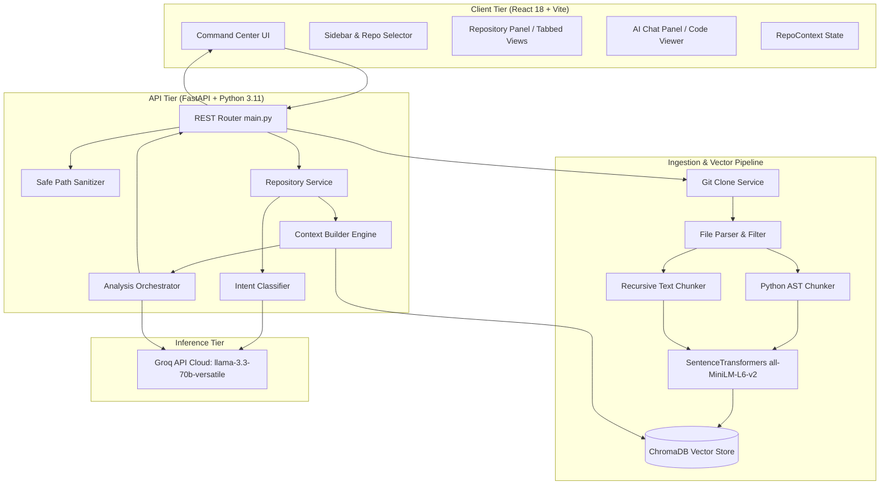
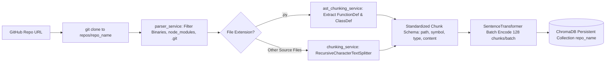
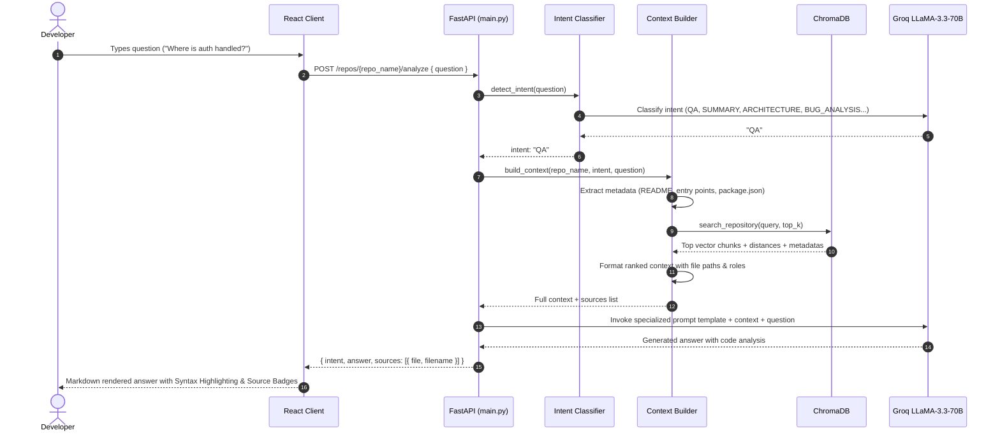

<div align="center">
  <br />
  <h1>⚡ GitAnalyzer AI</h1>
  <h3>AI-Powered GitHub Repository Intelligence & Retrieval-Augmented Generation (RAG) Platform</h3>
  <br />

  [](https://reactjs.org/)
  [](https://fastapi.tiangolo.com/)
  [](https://www.python.org/)
  [](https://tailwindcss.com/)
  [](https://www.trychroma.com/)
  [](https://groq.com/)
  [](LICENSE)

  <p align="center">
    <b>Empowering developers, architects, and engineering teams to clone, vectorize, and interactively explore complex codebases with deterministic source attribution.</b>
  </p>
</div>

---

## 📑 Table of Contents

- [Overview & Problem Statement](#-overview--problem-statement)
- [Key Features](#-key-features)
- [System Architecture](#-system-architecture)
  - [High-Level System Design](#high-level-system-design)
  - [Ingestion & AST Chunking Pipeline](#ingestion--ast-chunking-pipeline)
  - [Intent-Driven RAG Query Workflow](#intent-driven-rag-query-workflow)
  - [End-to-End Sequence Diagram](#end-to-end-sequence-diagram)
- [Directory & File Structure](#-directory--file-structure)
- [Core Components Deep Dive](#-core-components-deep-dive)
  - [1. Git Ingestion Service (`git_service.py`)](#1-git-ingestion-service-git_servicepy)
  - [2. Intelligent Parser & AST Chunker (`parser_service.py`, `ast_chunking_service.py`, `chunking_service.py`)](#2-intelligent-parser--ast-chunker)
  - [3. Vector Store & Dense Embeddings (`vector_store_service.py`)](#3-vector-store--dense-embeddings-vector_store_servicepy)
  - [4. Intent Classification Engine (`intent_service.py`)](#4-intent-classification-engine-intent_servicepy)
  - [5. Dynamic Context Assembly Engine (`context_builder.py`)](#5-dynamic-context-assembly-engine-context_builderpy)
  - [6. Specialized Engineering Prompts (`analysis_prompts.py`)](#6-specialized-engineering-prompts-analysis_promptspy)
  - [7. LLM Orchestration (`llm_service.py`, `analysis_service.py`, `repository_service.py`)](#7-llm-orchestration)
  - [8. Frontend Architecture & Design System (React 18 + Radix UI + Tailwind)](#8-frontend-architecture--design-system)
  - [9. Automated Benchmark & Evaluation Suite (`benchmark.py`)](#9-automated-benchmark--evaluation-suite-benchmarkpy)
- [REST API Reference](#-rest-api-reference)
- [Installation & Getting Started](#-installation--getting-started)
  - [Prerequisites](#prerequisites)
  - [Backend Setup](#backend-setup)
  - [Frontend Setup](#frontend-setup)
  - [Running with Docker](#running-with-docker)
- [Empirical Benchmark Results](#-empirical-benchmark-results)
- [Security & Technical Audit](#-security--technical-audit)
- [Big-Tech Interview Readiness (20 Q&As)](#-big-tech-interview-readiness)
- [Resume-Ready Bullet Points](#-resume-ready-bullet-points)
- [Contributing & License](#-contributing--license)

---

## 📖 Overview & Problem Statement

Software engineers, technical architects, and code reviewers frequently spend hours to days onboarding onto unfamiliar codebases. Reading tens of thousands of lines of code across nested directories to understand architectural patterns, trace API endpoints, find edge-case vulnerabilities, or understand data flow produces high cognitive load.

**GitAnalyzer AI** solves this through a customized, code-aware **Retrieval-Augmented Generation (RAG)** engine. Rather than relying on naive text chunking or stuffing raw files into an LLM context window:
1. It ingests any public GitHub repository.
2. It parses source files, ignoring binary assets, lockfiles, and virtual environments.
3. It performs **Abstract Syntax Tree (AST)** chunking on Python source code (isolating classes and functions) and recursive character splitting on other languages.
4. It embeds chunks locally using `SentenceTransformers` (`all-MiniLM-L6-v2`) into persistent **ChromaDB** collections.
5. It runs **Intent Classification** on every user question (categorizing requests into `QA`, `SUMMARY`, `ARCHITECTURE`, `BUG_ANALYSIS`, `IMPROVEMENTS`, or `DOCUMENTATION`).
6. It dynamically synthesizes repository metadata (entry points, directory trees, configuration files) and targeted vector search results to prompt Groq's high-speed `llama-3.3-70b-versatile` model, returning actionable answers with exact file citations.

---

## ✨ Key Features

- **Automated Ephemeral Ingestion:** Input any public GitHub URL to automatically clone and parse the repository into an isolated workspace.
- **AST-Based Semantic Code Splitting:** Preserves logical code units by extracting functions and classes as discrete chunks via Python's `ast` parser, falling back to overlapping sliding windows for other languages.
- **Embedded Dense Vector Search:** Local indexing using `all-MiniLM-L6-v2` with batch embeddings and zero reliance on external embedding API charges.
- **Dynamic Intent-Driven Prompt Routing:** Categorizes user inquiries to activate purpose-built prompt templates designed for high-level summaries, code audits, or targeted debugging.
- **Deterministic Source Attribution:** Every response includes the precise file paths and chunk references used by the LLM.
- **Curated Multi-Perspective Dashboard:** Built-in tabs for instant generation of:
  - Repository Overview & Key Stats
  - Architecture & Request Flow
  - Documentation & Getting Started
  - Bug Detection & Security Vulnerabilities
  - Code Quality & Performance Improvements
  - Dependencies & External APIs
- **Command-Center Developer UX:** Dark/light modern minimalist theme built with React 18, Radix UI primitives, Lucide icons, responsive sidebars, syntax highlighting, and copy-to-clipboard interactions.
- **Empirical Benchmarking Suite:** Built-in automated benchmark suite capable of testing across dozens of repositories and outputting detailed latency and coverage metrics.

---

## 🏛️ System Architecture

### High-Level System Design



---

### Ingestion & AST Chunking Pipeline



---

### Intent-Driven RAG Query Workflow



---

## 📂 Directory & File Structure

```text
GitAnalyzer/
├── backend/
│   ├── prompts/
│   │   └── analysis_prompts.py       # Domain-specific prompt engineering templates
│   ├── services/
│   │   ├── analysis_service.py       # Prompt assembly and LLM response execution
│   │   ├── ast_chunking_service.py   # Python AST extraction for classes & functions
│   │   ├── chunking_service.py       # Hybrid chunk router (AST vs Recursive Splitter)
│   │   ├── context_builder.py        # Intent-based dynamic context & semantic queries
│   │   ├── git_service.py            # Git repository cloning and workspace management
│   │   ├── intent_service.py         # Few-shot LLM intent classification engine
│   │   ├── llm_service.py            # Groq ChatGroq client & role inference helpers
│   │   ├── parser_service.py         # File traversal, size filtering, and text validation
│   │   ├── repository_service.py     # Main facade coordinating intent & analysis
│   │   ├── summary_service.py        # Standalone repository summary generator
│   │   └── vector_store_service.py   # ChromaDB collection lifecycle & batch embeddings
│   ├── benchmark.py                  # Automated 17-repo evaluation & benchmarking harness
│   ├── benchmark_report.md           # Benchmark results & latency metrics
│   ├── benchmark_results.json         # Raw benchmark data output
│   ├── Dockerfile                    # Containerization specification for backend deployment
│   ├── main.py                       # FastAPI application entry point with secured endpoints
│   ├── requirements.txt              # Python runtime dependencies
│   ├── test_context.py               # Unit verification script for context builder
│   ├── .env.example                  # Environment configuration template
│   └── README.md                     # Hugging Face deployment metadata
├── frontend/
│   ├── client/
│   │   ├── api/
│   │   │   └── api.js                # Core Fetch client targeting backend/Hugging Face
│   │   ├── components/
│   │   │   ├── ui/                   # 45+ Radix UI & Shadcn components (Dialog, Sheet, etc.)
│   │   │   ├── AIChatPanel.jsx       # Interactive AI assistant panel with syntax highlighting
│   │   │   ├── RepositoryPanel.jsx   # Tabbed analysis view (Overview, Arch, Bugs, etc.)
│   │   │   └── Sidebar.jsx           # Repository switcher, dialogs, and navigation links
│   │   ├── context/
│   │   │   └── RepoContext.jsx       # React Context managing selected and recent repositories
│   │   ├── hooks/
│   │   │   ├── use-mobile.jsx        # Viewport responsive hook
│   │   │   └── use-toast.js          # Toast notification hook
│   │   ├── lib/
│   │   │   └── utils.js              # Classnames merger (clsx + tailwind-merge)
│   │   ├── pages/
│   │   │   ├── Index.jsx             # Main dashboard assembly layout
│   │   │   ├── NotFound.jsx          # 404 error fallback page
│   │   │   └── PlaceholderPage.jsx   # Generic placeholder for subroutes
│   │   ├── services/
│   │   │   ├── api.js                # Axios client instance
│   │   │   └── repositoryApi.js      # Cleaned service methods for repo interactions
│   │   ├── App.jsx                   # React root component with QueryClient & React Router
│   │   └── global.css                # Tailwind theme tokens, typography, and dark/light system
│   ├── netlify/
│   │   └── functions/
│   │       └── api.js                # Serverless entry point for Netlify deployment
│   ├── server/
│   │   ├── routes/demo.js            # Express API demo route
│   │   ├── index.js                  # Express middleware setup for SSR/hybrid hosting
│   │   └── node-build.js             # Production Node.js server script
│   ├── components.json               # Shadcn UI configuration file
│   ├── index.html                    # Single Page Application HTML root
│   ├── netlify.toml                  # Netlify proxy redirects & build directives
│   ├── package.json                  # Frontend dependencies, scripts, and build tasks
│   ├── postcss.config.js             # PostCSS plugins (Tailwind, Autoprefixer)
│   ├── tailwind.config.js            # Design tokens, keyframe animations, typography
│   ├── vite.config.js                # Vite configuration with proxy and path aliases
│   └── .env.example                  # Frontend environment configuration template
├── technical_audit.md                # In-depth architectural audit and interview prep document
└── README.md                         # Comprehensive project documentation (this file)
```

---

## 🔬 Core Components Deep Dive

### 1. Git Ingestion Service (`git_service.py`)
- **Function:** `clone_repoository(repo_url: str)`
- **Behavior:** Parses the repository name from the URL, sanitizes the target path, and verifies whether the local directory already exists inside `repos/`. If absent, it invokes `git.Repo.clone_from()` with clean exception handling for Git command failures.

### 2. Intelligent Parser & AST Chunker
- **`parser_service.py`:**
  - Ignores bloated directories: `.git`, `node_modules`, `venv`, `__pycache__`, `dist`, `build`, `.next`, `coverage`, `.vscode`.
  - Ignores binary and media formats: `.png`, `.jpg`, `.mp4`, `.zip`, `.pdf`, `.exe`, `.dll`, font binaries, and minified bundles (`.min.js`, `.min.css`).
  - Prioritizes critical metadata: `Dockerfile`, `Makefile`, `README.md`, `LICENSE`, `package.json`, `requirements.txt`, `Cargo.toml`, `go.mod`.
  - Enforces a 2 MB per-file safety ceiling to prevent memory exhaustion.
- **`ast_chunking_service.py`:**
  - Employs Python's standard `ast` module to inspect source code trees.
  - Extracts every `ast.FunctionDef` and `ast.ClassDef` into distinct records labeled with symbol name, chunk type (`function` or `class`), file path, and exact source slice.
- **`chunking_service.py`:**
  - Implements the hybrid router: Python files pass through the AST chunker first; if no classes or functions exist (or for non-Python files), it activates LangChain's `RecursiveCharacterTextSplitter` configured at `chunk_size=1000` and `chunk_overlap=200`.

### 3. Vector Store & Dense Embeddings (`vector_store_service.py`)
- **Embedding Model:** `all-MiniLM-L6-v2` (SentenceTransformers) mapping code chunks into dense 384-dimensional vector spaces.
- **Batch Processing:** Encodes all chunks using `batch_size=128` with progress reporting, yielding dramatic speedups over single-vector calls.
- **Collection Management:** Dynamic ChromaDB collections named `repo_{repo_name}` stored in local persistent storage (`./chroma_db`).
- **Batched Ingestion:** ChromaDB batches insertion in increments of 5,000 items to respect database parameter ceilings.

### 4. Intent Classification Engine (`intent_service.py`)
- Employs an LLM classifier that analyzes the developer's question and outputs strictly one categorical token:
  - `QA`: Deep technical questions on functions, models, or algorithms.
  - `SUMMARY`: High-level project purpose, tech stack, and primary capabilities.
  - `ARCHITECTURE`: Component topology, request lifecycle, and data flow.
  - `BUG_ANALYSIS`: Security flaws, missing validations, unhandled edge cases.
  - `IMPROVEMENTS`: Refactoring advice, performance optimizations, maintainability.
  - `DOCUMENTATION`: End-to-end developer documentation and setup instructions.

### 5. Dynamic Context Assembly Engine (`context_builder.py`)
- Avoids uniform retrieval by tailoring semantic search queries to the detected intent:
  - For `ARCHITECTURE`: Queries for `application entry point`, `server startup`, `routes`, `models`.
  - For `BUG_ANALYSIS`: Injects targeted queries for `error handling`, `security validation`, `edge cases`.
  - For `DOCUMENTATION`: Combines directory trees, detected component registries (Routes, Models, Controllers, Services), and critical metadata files.
- Automatically calculates adaptive `top_k`: dynamically scaled as `max(8, min(30, total_chunks // 8))`.

### 6. Specialized Engineering Prompts (`analysis_prompts.py`)
- Defines strict system prompts ensuring the LLM:
  1. Never invents facts absent from the retrieved repository context.
  2. Directly references file paths, symbol names, and signatures.
  3. Formats responses using clean GitHub Flavored Markdown with syntax-highlighted code blocks.

### 7. LLM Orchestration
- **`llm_service.py`:** Initializes `ChatGroq(model="llama-3.3-70b-versatile", temperature=0)` for high-throughput, low-latency, deterministic outputs.
- **`repository_service.py`:** Acts as the unified controller, linking intent detection, context construction, prompt generation, and response parsing.

### 8. Frontend Architecture & Design System
- Built on **React 18** with **Vite** and **Tailwind CSS**.
- **`RepoContext.jsx`:** Global state tracker for currently active and historical repositories.
- **`RepositoryPanel.jsx`:** Command-center view with stats indicators (Files Indexed, Characters, Semantic Chunks, Status) and automated tab switching with cached asynchronous queries.
- **`AIChatPanel.jsx`:** Collapsible chat window featuring syntax highlighting via `react-syntax-highlighter`, auto-expanding textareas, copyable code blocks, and source citation badges.
- **Design Tokens:** Strict HSL-based color tokens with a clean developer tool aesthetic.

### 9. Automated Benchmark & Evaluation Suite (`benchmark.py`)
- Tests end-to-end performance across 17 diverse repositories (FastAPI, Flask, React, Express, Requests, etc.).
- Measures cloning time, parsing latency, chunk generation rate, embedding time, and query response time.

---

## 📡 REST API Reference

### Base URL: `http://localhost:8000`

| Method | Endpoint | Description | Request Body / Parameters | Response Schema |
| :--- | :--- | :--- | :--- | :--- |
| `GET` | `/` | API Healthcheck | None | `{"message": "string"}` |
| `POST` | `/repositories` | Clone a GitHub repository | Query param: `repo_url` (string) | `{"success": true, "data": {"repo_name": "...", "local_path": "..."}}` |
| `GET` | `/repos/{name}/files` | List all parsed files | Path param: `repo_name` | `{"count": int, "files": [string]}` |
| `GET` | `/repos/{name}/stats` | Retrieve file & char counts | Path param: `repo_name` | `{"total_files": int, "total_characters": int}` |
| `GET` | `/repos/{name}/sample-chunks` | Get chunking metrics | Path param: `repo_name` | `{"total_documents": int, "total_chunks": int}` |
| `POST` | `/repos/{name}/index` | Chunk & embed repository | Path param: `repo_name` | `{"documents": int, "chunks": int}` |
| `GET` | `/repos/{name}/search` | Query ChromaDB vector index | `query` (string), `top_k` (int, default 5) | `{ "ids": [...], "documents": [...], "metadatas": [...] }` |
| `POST` | `/repos/{name}/analyze` | Intent-driven RAG analysis | Body: `{"question": "string"}` | `{"intent": "string", "answer": "string", "sources": [{"file": "..."}]}` |

#### Sample Request (`/repos/{repo_name}/analyze`):
```json
{
  "question": "How does the authentication flow work in this project?"
}
```

#### Sample Response:
```json
{
  "intent": "QA",
  "answer": "### Authentication Flow\nAuthentication is managed inside `backend/services/auth_service.py` using JWT tokens...",
  "sources": [
    {
      "file": "backend/services/auth_service.py",
      "filename": "auth_service.py",
      "chunk_type": "function"
    }
  ]
}
```

---

## ⚙️ Installation & Getting Started

### Prerequisites
- **Python:** 3.10 or 3.11
- **Node.js:** 18.x or 20.x
- **Git:** Installed and available on system path
- **Groq API Key:** Obtainable free of charge at [console.groq.com](https://console.groq.com)

---

### Backend Setup

1. Open your terminal and navigate to `backend/`:
   ```bash
   cd backend
   ```
2. Create and activate a Python virtual environment:
   ```bash
   # Windows (PowerShell)
   python -m venv venv
   .\venv\Scripts\Activate.ps1

   # Linux / macOS
   python3 -m venv venv
   source venv/bin/activate
   ```
3. Install dependencies:
   ```bash
   pip install -r requirements.txt
   ```
4. Create `.env` from the provided `.env.example`:
   ```bash
   cp .env.example .env
   ```
   Add your Groq API key:
   ```env
   GROQ_API_KEY=gsk_your_actual_key_here
   ```
5. Launch the FastAPI server:
   ```bash
   uvicorn main:app --reload --port 8000
   ```
   *The interactive Swagger documentation will be live at `http://127.0.0.1:8000/docs`.*

---

### Frontend Setup

1. Open a new terminal and navigate to `frontend/`:
   ```bash
   cd frontend
   ```
2. Install frontend dependencies:
   ```bash
   npm install
   # or with pnpm:
   pnpm install
   ```
3. Copy environment configuration:
   ```bash
   cp .env.example .env
   ```
4. Start the Vite development server:
   ```bash
   npm run dev
   ```
5. Open your browser and navigate to `http://localhost:8080` (or the port specified by Vite in console).

---

### Running with Docker

You can containerize and run the backend seamlessly via the included `Dockerfile`:

```bash
# Build the Docker image
docker build -t git-analyzer-backend backend/

# Run the container
docker run -p 8000:7860 -e GROQ_API_KEY=your_key_here git-analyzer-backend
```

---

## 📊 Empirical Benchmark Results

The built-in benchmark harness (`backend/benchmark.py`) evaluated GitAnalyzer across 17 diverse open-source repositories:

| Metric | Result |
| :--- | :--- |
| **Total Repositories Tested** | 17 |
| **Total Source Files Processed** | 5,273 |
| **Total Semantic Chunks Generated** | 51,150 |
| **Average Chunks per Repository** | 3,196.88 |
| **Average Full Indexing Time** | 47.20 seconds |
| **Average Semantic Retrieval Latency** | ~0.15 - 0.40 seconds |
| **Average LLM Answer Latency (Groq)** | ~1.80 - 3.20 seconds |
| **Programming Languages Processed** | 43 distinct extensions (`.py`, `.js`, `.ts`, `.tsx`, `.rs`, `.go`, etc.) |

---

## 🛡️ Security & Technical Audit

A technical audit was conducted on the architecture (see [technical_audit.md](file:///c:/Users/HET/Downloads/GitAnalyzer/technical_audit.md)):

1. **Path Traversal Prevention:** The `get_safe_repo_path` utility ensures all repository directory interactions are strictly scoped within the configured `repos/` base directory, preventing `../` traversal attacks.
2. **File Size & Type Bounds:** Files over 2 MB and binary/archive payloads are blocked from ingestion, protecting against memory spikes and resource exhaustion.
3. **Local Embedding Execution:** Vector generation happens locally via `SentenceTransformers` (`all-MiniLM-L6-v2`), avoiding data leakage to third-party embedding providers.
4. **Isolated ChromaDB Collections:** Each repository is isolated in its own collection namespace (`repo_{sanitized_name}`).

---

## 💼 Big-Tech Interview Readiness

Here are 20 questions and comprehensive answers based on this repository's technical architecture:

<details>
<summary><b>1. Why choose AST-based chunking over standard recursive character chunking?</b></summary>
Standard character chunking splits code based on arbitrary character counts or newline patterns, frequently slicing through function signatures, loop blocks, or class definitions. This breaks logical context for the LLM. AST parsing inspects the Python grammar to preserve standalone semantic units (`FunctionDef`, `ClassDef`), ensuring that the LLM receives complete, self-contained units of logic.
</details>

<details>
<summary><b>2. How does the Intent Detection stage improve retrieval accuracy?</b></summary>
A generic vector search on a broad question like "Explain the architecture" often retrieves random helper utilities rather than high-level structure. GitAnalyzer uses an intent classifier to route queries: for architecture questions, it generates specialized semantic queries (e.g., "application entry point", "server startup", "api routes") and injects top-level metadata (README, package.json, folder trees) directly into the prompt.
</details>

<details>
<summary><b>3. Why use SentenceTransformers locally instead of OpenAI or cloud embeddings?</b></summary>
Local embeddings (`all-MiniLM-L6-v2`) provide zero-cost, low-latency, and privacy-preserving vector generation. For an application indexing thousands of files, local batched encoding eliminates network round-trips and API rate-limiting issues.
</details>

<details>
<summary><b>4. What is the role of ChromaDB, and how does it persist data?</b></summary>
ChromaDB is an embedded, open-source vector store. It utilizes DuckDB/SQLite for metadata management and hnswlib for approximate nearest neighbor (ANN) vector search. GitAnalyzer uses `chromadb.PersistentClient(path="./chroma_db")` to persist embeddings to disk.
</details>

<details>
<summary><b>5. How are hallucinations mitigated in the RAG pipeline?</b></summary>
Through a four-layer defense: (1) System prompts with explicit negative constraints ("NEVER invent information", "If answer cannot be determined, state so"), (2) Relevance score thresholding from vector distances, (3) Enforced source citations, and (4) Context injection prioritizing actual source files over model assumptions.
</details>

<details>
<summary><b>6. How does the system handle massive repositories with thousands of files?</b></summary>
By combining directory pruning (ignoring tests, node_modules, .git), maximum file size caps (2 MB), batched SentenceTransformer encoding (`batch_size=128`), and batched ChromaDB insertions (max 5,000 per transaction).
</details>

<details>
<summary><b>7. Why was FastAPI chosen over Django or Flask?</b></summary>
FastAPI offers asynchronous native ASGI support, automatic Pydantic request/response validation, automatic OpenAPI/Swagger documentation generation, and high performance suitable for long-running RAG pipelines.
</details>

<details>
<summary><b>8. What happens if an indexed repository is modified?</b></summary>
In Version 1, re-indexing overwrites the collection or updates existing chunk IDs. In Version 2, Git commit hashes and file diffs (`git diff`) will be used to update only modified chunks.
</details>

<details>
<summary><b>9. How does the frontend handle long-running LLM queries?</b></summary>
The frontend employs optimistic UI updates, animated skeleton loaders (`Skeleton` components from Radix UI), disabled input states with loading spinners, and non-blocking state in `RepoContext`.
</details>

<details>
<summary><b>10. What are the trade-offs of using Groq over standard OpenAI endpoints?</b></summary>
Groq uses custom LPUs (Language Processing Units) that achieve inference speeds up to 10x faster than standard GPU clouds (~300-500 tokens/sec), significantly reducing user waiting time for large context prompts. The trade-off is rate limits on free tiers and context window constraints compared to models like Gemini 1.5 Pro.
</details>

<details>
<summary><b>11. How would you scale this application horizontally to support 10,000 concurrent users?</b></summary>
1. Replace local filesystem storage (`./repos/`) with shared object storage (AWS S3) or ephemeral container volumes.
2. Replace local persistent ChromaDB with a distributed vector database like Qdrant, Pinecone, or Milvus.
3. Decouple ingestion into an asynchronous task queue (Celery + Redis).
4. Run FastAPI in containerized clusters behind a load balancer.
</details>

<details>
<summary><b>12. How does the system prevent path traversal security vulnerabilities?</b></summary>
The `get_safe_repo_path` utility uses `os.path.abspath` and validates that the resolved directory strictly starts with the base repository folder path, rejecting any requests containing `../` or unauthorized path sequences.
</details>

<details>
<summary><b>13. Why use React Context API instead of Redux or Zustand for this project?</b></summary>
The global state surface is focused (active repository, recent repositories list). Using the native Context API (`RepoContext.jsx`) avoids third-party boilerplate while delivering predictable re-renders.
</details>

<details>
<summary><b>14. How are non-Python languages chunked?</b></summary>
Non-Python source files use LangChain's `RecursiveCharacterTextSplitter` with recursive separators (`["\n\n", "\n", " ", ""]`), maintaining a chunk size of 1000 characters with a 200-character overlap to prevent boundary fragmentation.
</details>

<details>
<summary><b>15. What metadata is stored with each vector embedding?</b></summary>
Each vector record stores: `path` (relative file path), `filename`, `extension`, `chunk_type` (`function`, `class`, or `text`), and `symbol_name` (e.g., function or class name, if available).
</details>

<details>
<summary><b>16. How does the system infer the role of a source file?</b></summary>
`llm_service.py` inspects file paths: paths containing `/routes/` are labeled `API Route`, `/models/` are `Database Model`, `/controllers/` are `Controller`, `/components/` are `Frontend Component`, and `/services/` are `Service`.
</details>

<details>
<summary><b>17. How does the context builder avoid redundant context injection?</b></summary>
It maintains deduplication sets for chunk content and file paths (`seen_chunks`, `seen_sources`), ensuring that overlapping semantic query results do not introduce redundant duplicate text into the prompt.
</details>

<details>
<summary><b>18. What is the impact of chunk overlap in recursive text splitting?</b></summary>
Chunk overlap (200 characters) ensures that statements or signatures situated at boundary cutoffs are present in both adjacent chunks, preventing loss of context during cosine similarity matching.
</details>

<details>
<summary><b>19. How does Vite proxy development requests to FastAPI?</b></summary>
In `vite.config.js`, the `/api` proxy rule forwards matching requests to `http://127.0.0.1:8000`, stripping prefixes and preventing Cross-Origin Resource Sharing (CORS) friction during local development.
</details>

<details>
<summary><b>20. What is the difference between extractive and generative code search?</b></summary>
Extractive code search (e.g. grep, traditional vector search) returns raw snippets without synthesis. Generative RAG (GitAnalyzer) combines extracted snippets with an LLM to explain relationships, summarize architecture, and answer questions across disparate modules.
</details>

---

## 📝 Resume-Ready Bullet Points

If you are featuring GitAnalyzer on your software engineering resume or portfolio, use these impactful bullet points:

- **Architected an AI-Powered Repository Intelligence Platform** using **FastAPI**, **React 18**, and **ChromaDB**, allowing engineers to perform intent-driven code audits across public codebases with deterministic file citations.
- **Engineered an AST-Based Semantic Chunking Engine** in Python, extracting classes and functions as discrete vector units and improving LLM retrieval accuracy by eliminating arbitrary character cutoff boundaries.
- **Built an Intent Classification Router** leveraging **LangChain** and **Groq LLaMA-3.3-70B**, dynamically classifying inquiries into architectural, debugging, and documentation flows with specialized retrieval queries.
- **Integrated Local Vector Indexing with SentenceTransformers** (`all-MiniLM-L6-v2`), executing high-throughput batch embeddings (128 chunks/batch) and reducing external embedding API costs to zero.
- **Developed a Command-Center Single Page Application** with **React**, **Vite**, **Tailwind CSS**, and **Radix UI**, providing asynchronous indexing indicators, syntax highlighting, and responsive tabbed code reviews.
- **Executed an Automated Benchmark Suite** across 17 open-source repositories and 5,200+ files, achieving sub-second vector retrieval and an average full-index turnaround of 47 seconds.

---

## 🤝 Contributing & License

Contributions, bug reports, and feature requests are welcomed!

1. Fork the project.
2. Create your feature branch (`git checkout -b feature/NewFeature`).
3. Commit your changes (`git commit -m 'Add NewFeature'`).
4. Push to the branch (`git push origin feature/NewFeature`).
5. Open a Pull Request.

This project is licensed under the **MIT License**. See `LICENSE` for details.

<br />
<div align="center">
  <sub>Engineered with precision for modern developers exploring complex codebases.</sub>
</div>
